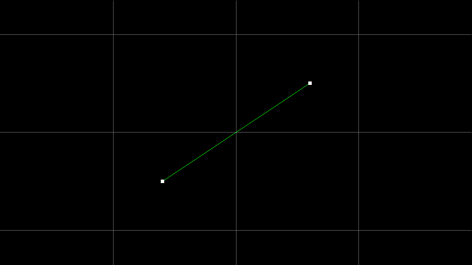
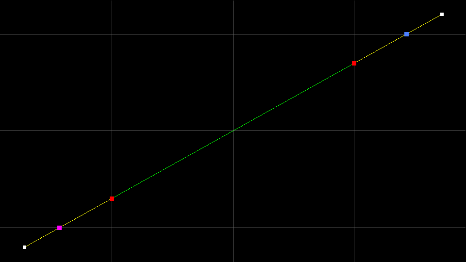
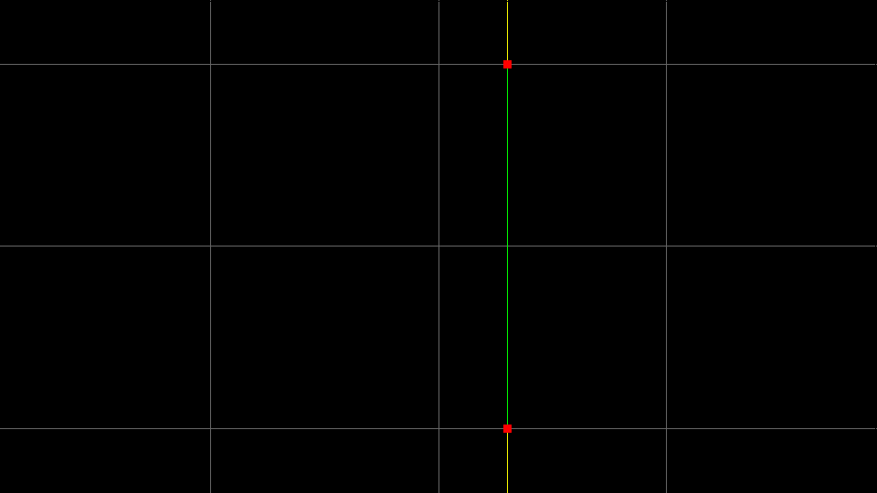
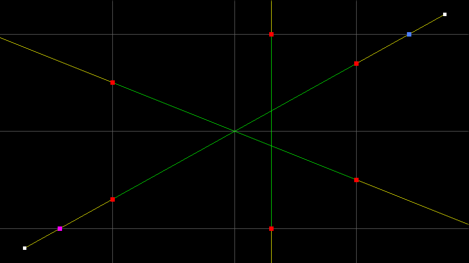
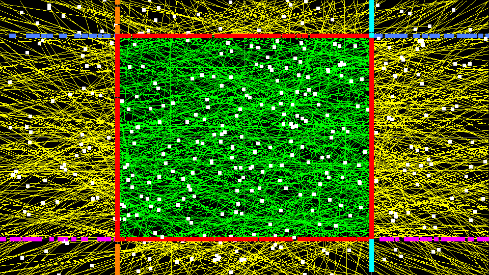

# Lab 07: Cohen–Sutherland Line Clipping

Name: Anirban Roy Sourov  
Roll: 32  
Date: 09 November 2026

## Run

From the repository root, activate the project environment and run:

```bash
source .venv/bin/activate
python 07_lab_09_Nov_26/07_lab_09_Nov_26.py
```

Press **q** to generate a pair of random endpoints. Endpoints may lie outside the actual OpenGL window. Accepted lines accumulate; rejected lines are neither drawn nor saved.

## Implementation

The actual window is 960×540, with centered coordinates. The smaller clipping rectangle is:

```text
xmin = -250       xmax = 249
ymin = -200       ymax = 199
```

`region_code()` assigns four outside bits: left `1`, right `2`, bottom `4`, top `8`. Points on an edge count as inside.

`cohen_sutherland()` repeatedly performs these steps:

1. Calculate both endpoint codes.
2. If their bitwise OR is zero, accept the segment.
3. If their bitwise AND is nonzero, reject the segment because both endpoints are outside the same side.
4. Otherwise, choose an outside endpoint, intersect the segment with one boundary indicated by its code, replace that endpoint, and repeat.

The function returns the accepted endpoints or `None`. It leaves the original endpoints unchanged.

All lines, including axes and guides, use **Bresenham's algorithm**. Each segment pixel is emitted once with its final color. As requested, an accepted segment retains its original outside portions as a visualization of clipping; only the green part is the clipped result. A wholly rejected segment has no visible yellow portion.

| Color | Meaning |
| --- | --- |
| Gray | Axes and extended boundary guides |
| White rectangle | Bright border of the small clipping rectangle |
| Green | Inside portion of an accepted segment |
| Yellow | Outside portions of that accepted segment |
| Red dots | Actual intersections with the small rectangle's edges |
| Orange / cyan dots | Outside intersections on the extended `xmin` / `xmax` guides |
| Magenta / blue dots | Outside intersections on the extended `ymin` / `ymax` guides |
| White dots | Original endpoints, if visible in the actual window |

There are at most two red markers per segment. A segment wholly inside has none, and a segment with one endpoint inside usually has one. Crossings of the original accepted segment with the extended boundary lines outside the rectangle have additional markers, colored by the guide they cross. Only crossings between the original endpoints are marked; the segment itself is not extended. Wholly rejected segments still add no lines or markers. Off-screen markers are naturally hidden by the actual OpenGL window.

The source includes comments on the region bits, clipping decisions, intersection equations, Bresenham steps, keyboard input, and double buffering.

## Output screenshots

These are captures of the actual OpenGL rendering, using known endpoint pairs to demonstrate each case. Normal execution still uses random endpoints.

### 1. Fully inside: accepted without clipping

Endpoints: `(-150, -100)` and `(150, 100)`. The whole segment is green, its endpoints are white, and no edge intersection markers are needed.



### 2. Crossing the rectangle: clipped at two edges

Endpoints: `(-430, -240)` and `(430, 240)`. Clipped endpoints are approximately `(-250, -139.53)` and `(249, 138.98)`. The inside is green, the outside is yellow, and both intersections are red.



### 3. Endpoints outside the actual OpenGL window

Endpoints: `(75, -500)` and `(75, 500)`. The accepted endpoints are `(75, -200)` and `(75, 199)`. The original white endpoint markers are outside the visible window, but the visible line and red intersection markers still appear.



### 4. Previous accepted lines remain

Three accepted segments appear together: the vertical and diagonal examples above, plus `(-800, 320)` to `(800, -320)`. Generating another accepted line does not remove previous ones.



### 5. A rejected segment adds nothing

The next attempted segment is `(-400, 240)` to `(400, 240)`. Both endpoints are above `ymax = 199`, so both codes contain the TOP bit and Cohen–Sutherland rejects it.

The terminal reports:

```text
Original endpoints: (-400, 240) -> (400, 240)
Rejected: no part lies inside the rectangle. Nothing added.
```

The following image intentionally matches screenshot 4: the rejected line and its endpoints are absent, and all previously accepted lines remain. The captured pixels were checked to be identical before and after this rejection.


### 6. After 1,000 q presses

The actual keyboard handler was invoked 1,000 times with `b'q'`, using random seed `32` for reproducibility. Of the 1,000 generated segments, **506 were accepted and retained**, and **494 were rejected**. This is 1,000 generation attempts, not 1,000 accepted lines.

The screenshot shows the accumulated accepted segments, their green inside portions, yellow outside portions, white visible endpoints, and red rectangle-edge intersections.


